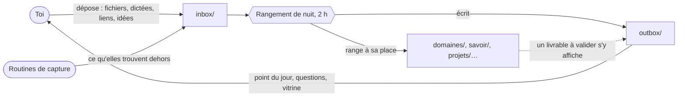
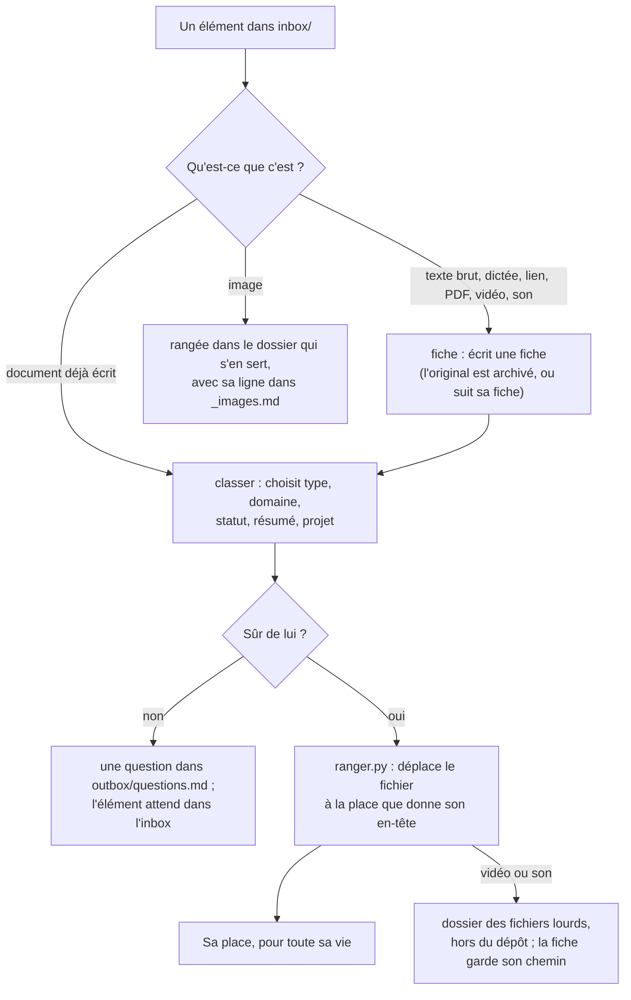
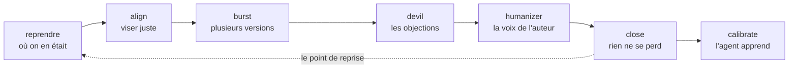
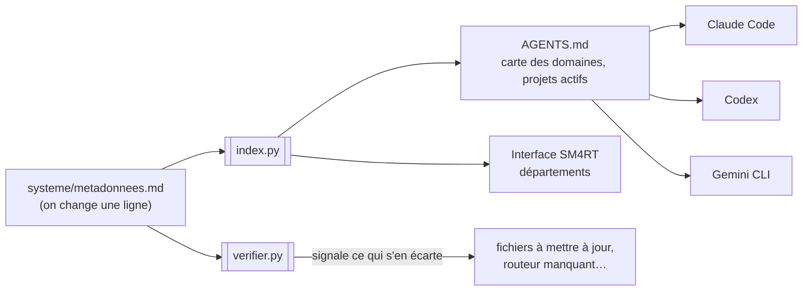

# AIOS v2, expliqué

> Pour qui : une personne qui ne code pas, et qui veut comprendre ce qu'est AIOS avant de l'installer ou de le présenter.
> Le mode d'emploi technique est dans le [README](../README.md). Le pourquoi de chaque choix est dans le [journal de conception](decisions.md).

## En une phrase

AIOS est un dossier de fichiers bien rangé, que ton agent IA (Claude Code, Codex ou Gemini CLI) sait lire, tenir à jour et ranger tout seul, même la nuit.

## Le problème qu'il règle

Quand on travaille avec une IA, trois choses se perdent :

- **Le contexte.** À chaque discussion, il faut réexpliquer qui on est, ce qu'on fait, ce qu'on vise.
- **Le rangement.** Les notes, les dictées, les PDF et les liens s'empilent quelque part, et personne ne les range.
- **La suite.** Ce que l'IA produit reste dans une conversation, puis disparaît.

AIOS règle les trois avec une idée simple : tout vit dans des fichiers texte, rangés selon des règles que l'IA connaît. Ce qu'elle sait de toi, elle le relit dans un fichier. Ce qu'elle produit, elle le range à sa place. Et ce qui arrive en vrac, elle le trie chaque nuit.

## Les principes

### 1. Un seul fichier de règles, pour tous les agents

`AGENTS.md` dit à l'agent qui tu es, ce que tu vises, comment tu travailles et où chercher. C'est le seul qui fait foi. `CLAUDE.md` ne fait que l'importer, et Gemini CLI est réglé pour le lire.

*Exemple : tu passes de Claude Code à Gemini CLI. Tu ne changes rien dans tes fichiers : seule la commande qui lance l'agent change.*

### 2. Un réglage, un seul endroit

Les domaines de ton activité, les sortes de fichiers que tu produis et leurs étapes se règlent dans un seul fichier : `systeme/metadonnees.md`. On change une ligne, puis un script recopie le changement partout où il sert.

*Exemple : tu ajoutes le domaine « contenu » dans ce fichier. La carte des domaines d'`AGENTS.md`, que tous les agents lisent, et l'interface SM4RT suivent d'elles-mêmes. Tu n'écris jamais ces copies à la main.*

### 3. Ranger, c'est donner les bonnes informations : la place s'en déduit

Chaque fichier texte commence par un petit en-tête : ce qu'il est (son **type**), la partie de ton activité où il vit (son **domaine**), où il en est (son **statut**), un résumé d'une ligne, sa date de naissance. Avec ces informations, sa place est connue d'avance.

*Exemple : un compte rendu de réunion du domaine « clients », daté du 23 octobre, va toujours dans `domaines/clients/<nom>-26-10.md`. Personne n'a à choisir sa place : elle découle de l'en-tête.*

### 4. Ce qui bouge est une information, pas un dossier

Le statut d'un fichier change au fil de sa vie. Il est écrit dans l'en-tête, jamais dans le nom d'un dossier. Un fichier garde donc sa place toute sa vie. Le type non plus n'est pas un dossier : il est dans l'en-tête. Seul le domaine est un dossier.

*Exemple : une vidéo passe de `sujet` à `en-cours`, puis à `a-valider`, puis à `publie`. On change un mot dans son en-tête ; le fichier ne bouge pas, et aucun lien vers lui ne casse.*

### 5. Un mot a un seul sens

Un mot est soit un type, soit un statut, jamais les deux.

*Exemple : « idée » servait à la fois de sorte de fichier et de première étape d'un contenu. Le premier statut d'un contenu s'appelle donc `sujet`.*

### 6. Un champ n'existe que si quelque chose s'en sert

On n'ajoute pas d'information « au cas où ». Le champ `cree` (la date de naissance) existe parce que le rangement s'en sert pour nommer un fichier daté.

### 7. Le jugement à l'IA, le mécanique au script

Choisir le type ou le domaine d'un document demande du jugement : c'est le travail de l'IA. Déplacer un fichier au bon endroit est mécanique : c'est le travail d'un petit script, sans IA, qui ne se trompe pas et ne coûte rien.

### 8. Dans le doute, l'IA demande au lieu de deviner

La nuit, l'agent travaille seul. Quand il hésite, il ne devine pas : il met l'élément de côté et note sa question, avec sa proposition. Tu réponds dans la journée, quand tu veux.

### 9. Le socle est neutre et portable

Le « socle » est la partie commune à tous les AIOS : règles, scripts, skills de base. Il ne contient rien de personnel. Ta personnalisation va dans des endroits précis (ton profil dans `AGENTS.md`, tes domaines dans la section « Ce workspace » de `systeme/metadonnees.md`, ta mémoire, tes projets). Tu peux donc récupérer les mises à jour du socle sans perdre ce qui est à toi.

## Au quotidien : deux portes

Tu n'as que deux dossiers à connaître. Tout le reste est rangé pour l'IA.

- **`inbox/`, la porte d'entrée.** Tu y déposes tout, en vrac : un fichier, une dictée, un lien, une note. Le fichier `inbox/capture.md` sert aux idées rapides : une par ligne.
- **`outbox/`, la porte de sortie.** Tu y lis le point du jour (`outbox/points/`), les questions qui attendent ta réponse (`outbox/questions.md`) et une page (`outbox/index.html`) qui montre ce qui est prêt.

Chaque nuit à 2 h, le rangement vide l'inbox, range chaque élément à sa place et t'écrit le point du jour.

Deux règles tiennent ces portes propres :

- **L'outbox est une vitrine, pas un rangement.** Un livrable reste dans son domaine. Il apparaît dans la page de l'outbox grâce à son statut `a-valider`. *Exemple : une proposition commerciale à relire reste dans `domaines/clients/` ; tu la vois dans l'outbox tant qu'elle attend ta validation.*
- **La nuit, aucune question.** Ce qui demande une réponse attend dans `outbox/questions.md`. En début de session, l'agent te dit combien il y en a et propose d'y répondre.

### Le chemin d'un élément, de l'inbox à sa place

Le rangement est découpé en trois métiers :

- `fiche` **crée** : elle écrit une fiche propre à partir d'un texte brut, d'une dictée, d'un lien ou d'un fichier qui ne peut pas porter d'en-tête (un PDF, une vidéo).
- `classer` **choisit les informations** : le type, le domaine, le statut, le résumé, le projet.
- `ranger.py` **déplace** : un script, sans IA, qui met le fichier à la place que donne son en-tête.

La routine `rangement` enchaîne les trois, chaque nuit.

Trois cas particuliers :

- **Un fichier qui ne peut pas porter d'en-tête** (un PDF, un lien, une vidéo) reçoit une fiche compagnon, à son nom, qui le résume et lui sert d'index. *Exemple : `contrat-x.md` décrit `contrat-x.pdf`, et les deux vivent côte à côte.*
- **Une image** n'a pas d'en-tête : elle a sa ligne dans le fichier `_images.md` de son dossier (ce qu'elle montre, d'où elle vient, à quoi elle sert).
- **Les vidéos et les sons** sont trop lourds pour le dépôt. Ils vont dans un dossier à part, par exemple un dossier Google Drive synchronisé, réglé une fois dans `.env` (ligne `FICHIERS_LOURDS`). Leur fiche, elle, reste dans le workspace et garde leur chemin.

### La preuve : une vraie nuit

La vraie routine de nuit a tourné sur un faux AIOS : deux domaines, six éléments dans l'inbox. En une minute :

- la dictée d'un appel est devenue un compte rendu dans le domaine `clients`, et l'original a été archivé ;
- un document sans en-tête est devenu un concept ;
- une ligne de capture est devenue un sujet de newsletter ;
- le vieux point du jour a été archivé, et les routeurs mis à jour ;
- trois éléments ont été mis de côté, sans rien deviner : un PDF illisible, une vidéo sans contexte, une idée qu'aucun domaine ne couvrait ;
- le point du jour a même rappelé l'échéance de la proposition.

## L'installation

### 1. Préparer son profil, avec grill-me

Avant un atelier, chacun prépare son profil. La skill `grill-me` pose une liste de quatorze questions imposées, une à la fois, avec à chaque fois une réponse proposée à confirmer ou corriger. Les blocs : identité (le nom et le rôle de ton agent, qui tu es, comment il doit te parler : tu ou vous, le tutoiement par défaut), objectifs (tes trois cibles de l'année, tes objectifs du trimestre), domaines et revenus, projets en cours, outils, routines, mémoire, fichiers lourds.

Chaque réponse est notée au fur et à mesure dans une fiche. Une question sans réponse s'écrit « À définir » : elle reviendra plus tard dans le point du jour. À la fin, on obtient un profil rempli. Sans dépôt sous la main, on peut donner les trois fichiers de `skills/installation/references/` à n'importe quel Claude.

### 2. Installer en une phrase

On donne à son agent l'adresse du socle et son profil :

> Installe-moi l'AIOS : https://github.com/thomrichard/aios-V2. Mon profil est ici : <chemin du fichier>. Installe-le dans <dossier>.

L'agent récupère le socle, dépose le profil dans l'inbox et lance l'installation. Il reprend chaque réponse, la montre bloc par bloc pour validation, puis ne pose que les questions restées sans réponse. Il remplit `AGENTS.md`, crée un routeur par domaine (une fiche courte qui dit où vit quoi dans ce domaine), vérifie le workspace, et termine par un résumé de ce qui reste « À définir ».

### 3. Le catalogue propose, tu choisis

« Tout est réglable » peut faire peur au départ. Alors l'installation ne part pas d'une page blanche :

1. elle explique trois mots, avec un exemple :
   - **domaine** : une grande partie de ton activité, qui dure (par exemple « contenu ») ;
   - **type** : la sorte de fichier que tu y produis (une vidéo, une newsletter, une proposition) ;
   - **statut** : où en est un fichier dans sa vie (une vidéo passe de `sujet` à `en-cours`, à `a-valider`, puis à `publie`) ;
2. elle propose des domaines et des types tirés d'un catalogue (contenu, clients, produits, communauté, perso…), choisis d'après ton métier ;
3. tu gardes, tu renommes ou tu retires.

Le socle marche déjà sans rien régler : il fournit le domaine `operations` (pilotage, admin, l'AIOS lui-même) et des types de base (projet, livrable, compte rendu, concept, source…). Le catalogue ajoute ce qui te ressemble. Chacun repart avec son AIOS.

## Une journée de travail avec l'agent

Quelques skills courtes suivent le fil d'une journée. Aucune n'est obligatoire : chacune se lance quand elle sert, par son nom (« reprendre », « align »…).

| Skill | Quand | Ce qu'elle fait | Trace écrite |
|---|---|---|---|
| `reprendre` | en ouvrant une session sur un sujet déjà commencé | redonne le point : où on en est, décidé, ouvert, prochaine action | non, elle lit |
| `align` | juste avant une tâche floue ou coûteuse | quelques questions à choix, toutes d'un coup | non |
| `burst` | quand on veut choisir plutôt que corriger | plusieurs variantes vraiment différentes d'un livrable | la version retenue |
| `surprise-me` | quand une création visuelle sort « propre mais banale » | une autre direction, poussée loin, relue sur capture avant d'être montrée | la version retenue |
| `devil` | avant de s'engager sur un choix ou un livrable | des objections sérieuses, puis un verdict | non |
| `humanizer` | avant de publier un texte écrit avec l'IA | retire les tics d'écriture « IA », garde la voix de l'auteur | le texte, si tu le demandes |
| `close` | en fin de session | range tout ce qui compte, écrit le point de reprise | oui |
| `calibrate` | en fin de session, après des corrections | propose de faire apprendre l'agent | oui, après ton choix |

### reprendre : se remettre à niveau en une minute

Une nouvelle session ne sait rien de la veille. Tu dis « reprends le site web ». L'agent cherche le sujet (les projets actifs, le routeur du domaine, le journal, les bilans de clôture), lit l'essentiel, puis te donne le point en quelques lignes : où on en est, ce qui est décidé (et ce qu'on a écarté), ce qui reste ouvert, et une seule prochaine action. Il n'écrit rien : il lit.

C'est l'autre moitié de `close` : `close` écrit le point de reprise, `reprendre` le relit. Le fichier du projet (`projets/<slug>.md`) sert de dossier partagé entre les sessions, même lancées en parallèle.

### align : viser juste du premier coup

Un brief flou fait tâtonner l'agent. Avec `align`, il pose d'abord quelques questions numérotées, chacune avec deux à quatre réponses (a, b, c), sa recommandation en premier. Trois questions par défaut, le nombre demandé sinon, cinq au plus. Il ne demande jamais ce qu'il peut lire dans le workspace.

*Exemple : « écris un post LinkedIn sur l'atelier ». L'agent demande : 1. Pour qui ? 2. Quel but ? 3. Quelle longueur ? Tu réponds en une ligne, « 1a, 2c, 3b », il redit la cible en une phrase, puis il écrit.*

S'il faut plus de cinq questions, ou s'il s'agit de décider plutôt que d'exécuter, `align` renvoie à `grill-me`.

### burst : choisir plutôt que corriger

Corriger une seule version, c'est lent. Avec `burst`, l'agent produit d'un coup plusieurs variantes complètes (trois par défaut, cinq au plus), chacune sur un axe annoncé : l'angle, le ton, la structure, la longueur, le style. Tu choisis : « B », « A avec la fin de C », ou « burst sur B » pour varier encore à partir d'elle. Pas de quasi-doublons : deux variantes trop proches, et l'une est remplacée. Un visuel ou une page s'affiche côte à côte, dans une seule page.

### surprise-me : sortir du « propre mais banal »

Le premier jet d'un modèle est le plus probable : propre, et déjà vu partout. Pour une création visuelle (une page, une slide, un visuel), `surprise-me` en sort. L'agent écrit en une ligne ce qu'il aurait fait par défaut, puis annonce une tout autre direction. Il impose au moins trois techniques avancées (une animation au défilement, une typographie très contrastée, une mise en page asymétrique…). Puis il se relit : il capture le rendu sur ordinateur et sur mobile, le critique, le corrige, et recommence, deux à quatre fois, avant de te montrer quoi que ce soit. Ta charte reste : tes couleurs et tes polices ne bougent pas, c'est la forme qui ose. Sans moyen de capture, il critique à partir du code, et il dit clairement qu'il n'a pas vu le rendu.

*Un essai réel : une page d'annonce pour l'atelier « Construis ton AIOS ». Sans autorisation de capture, l'agent l'a dit franchement plutôt que de faire semblant. Avec l'autorisation, la boucle a trouvé un défaut grave, invisible à la lecture du code : tout le bas de la page restait masqué. Elle l'a réparé, puis elle a corrigé la taille du titre et la mise en page sur mobile. Montrer seulement ce qu'on a vu change le résultat.*

`burst` et `surprise-me` se complètent : `burst` donne plusieurs directions à comparer ; `surprise-me` pousse une seule direction beaucoup plus loin, en se relisant.

### devil : l'avocat du diable

Un modèle a tendance à dire oui. `devil` cherche sérieusement ce qui cloche : trois objections par défaut, de la plus grave à la moins grave. Chacune dit ce qui la fonde et ce qui la lèverait. L'agent vérifie dans le workspace au lieu de supposer, puis donne son verdict : on y va, on y va après avoir levé telle objection, ou on revoit le choix. S'il y a moins d'objections sérieuses que demandé, il le dit au lieu d'en inventer.

*Exemple, un essai réel : brancher un MCP communautaire pour Airtable, tenu par un seul mainteneur. `devil` a donné trois objections fondées sur `systeme/connexions.md` (l'ordre de préférence des connexions) et sur la règle des clés, puis un verdict.*

### humanizer : que le texte sonne comme son auteur

Un texte écrit avec l'IA garde des tics qui le rendent plat : la triade « simple, rapide et efficace », le « ce n'est pas X, c'est Y », la question rhétorique en accroche, les mots gonflés. `humanizer` les repère, à l'aide d'une liste d'une quarantaine de motifs en français (`skills/humanizer/references/motifs.md`), et réécrit le texte : même sens, mêmes faits, à peu près la même longueur. Ta charte d'écriture, si elle est dans ta mémoire, passe avant tout. Il a quatre modes selon le support : script (lu à voix haute), newsletter, post, page. « humanizer liste » nomme seulement les tics, sans toucher au texte.

Le but n'est pas de tromper un détecteur : c'est que le texte sonne comme toi, et qu'il dise les choses plus clairement. Il n'invente ni fait ni anecdote pour « faire humain ».

### Et grill-me ?

`align` ne double pas `grill-me`. Chacune a son usage :

| Skill | Pour | Comment | Combien de temps | Trace écrite |
|---|---|---|---|---|
| `grill-me` | explorer une idée, décider, préparer un gros projet | une question à la fois, avec une réponse proposée | 15 à 45 minutes | oui, une fiche d'entretien |
| `align` | viser juste avant d'exécuter | quelques questions à choix, toutes d'un coup | 30 secondes | non |
| `devil` | contredire avant de s'engager | des objections sérieuses, puis un verdict | quelques minutes | non |

`reprendre`, `align`, `burst`, `surprise-me`, `devil` et `humanizer` sont réécrites d'après ce que Jay E | RoboNuggets montre de ses skills en vidéo : ses fichiers ne sont pas publics. `reprendre` s'appelle `onboard` chez lui.

## La fin de session : close, puis calibrate

Une discussion avec l'agent finit toujours par disparaître. On perd rarement la décision ; on perd le chemin : les options écartées, et pourquoi. `close` règle ça : après elle, le chat peut disparaître sans rien perdre. Tu dis « close », ou « on ferme ».

Elle travaille en cinq temps :

1. **L'inventaire.** L'agent relit la session et trie en quatre : les décisions (avec leur pourquoi), les livrables, ce qui n'existe que dans le chat (un texte proposé, une analyse), les sujets ouverts. Il te montre cet inventaire avant d'écrire quoi que ce soit.
2. **Chaque chose à sa place.** Une décision va dans `journal/decisions.md`, avec ce qu'on a écarté. Ce qui n'existe que dans le chat devient une fiche, rangée par `classer` ; dans le doute, une ligne dans `inbox/capture.md`. Un projet touché est mis à jour. Une préférence durable devient un souvenir. Chaque chantier laisse sa ligne dans `journal/log.md`.
3. **Chaque sujet ouvert devient une tâche à reprendre** : dans son projet, dans un nouveau projet qu'il propose, ou en ligne de capture que le rangement de nuit rangera.
4. **Rien ne traîne.** Un livrable promis mais jamais écrit est écrit. Un programme lancé est arrêté ou signalé. Des changements non enregistrés dans Git sont signalés, avec un commit proposé ; jamais d'envoi en ligne sans ton accord. Puis l'agent lance le vérificateur.
5. **Le récap**, en quelques lignes : ce qui est fait, où c'est écrit, ce qui attend, et la phrase exacte pour reprendre chaque sujet. C'est ce point de reprise que `reprendre` relira à la session suivante. Si tu l'as corrigé pendant la session, il propose `calibrate`.

Une session longue laisse aussi un bilan dans `journal/clotures/<sujet>-AA-MM.md` : le périmètre, ce qui est fait, les décisions, les propositions non engagées, les limites.

Les deux skills se partagent le travail : `close` garde le **contenu** de la session ; `calibrate` (plus bas) fait **apprendre l'agent** (ses règles, ses skills). `close` ne touche jamais aux règles ni aux skills.

*Un essai réel, en deux temps : une session de travail sur un projet de site web, puis « close ». Le choix d'Astro a été noté, avec son pourquoi et les options écartées. Le projet a été mis à jour, et la liste des projets actifs d'`AGENTS.md` a suivi. L'accroche rédigée dans le chat a été gardée. La préférence « phrases courtes » est devenue un souvenir. Un commit a été proposé, pas fait. Le récap a donné une phrase de reprise par sujet.*

`close` est reprise de la skill close de Thomas (classroom « Faire vivre ton AIOS »), adaptée à AIOS v2.

## Comment l'AIOS s'améliore

Le but : une correction donnée une fois ne revient pas. L'agent s'ajuste à toi, session après session. Trois outils s'en chargent, et rien ne change sans ton accord.

- **« Retiens ».** Une préférence ou un fait qui doit durer devient un souvenir dans `memory/`, avec sa ligne dans `memory/MEMORY.md`. *Exemple : « retiens que je tutoie mes clients ».*
- **`note` : mettre un retour de côté.** Tu remarques qu'une skill pourrait mieux faire, mais tu es en plein travail. Tu dis « note pour classer : … ». L'agent écrit une ligne dans `skills/classer/feedback.md`, puis reprend là où vous en étiez. Il ne touche pas à la skill. Plus tard, à froid, tu dis « applique les retours de classer » : il propose les changements, tu choisis, il les applique. Chaque retour traité est coché, jamais effacé.
- **`calibrate` : le point de fin de session.** L'agent relit la discussion. Il cherche tes corrections (« non, pas ça »), tes préférences, les étapes oubliées, ce qui est revenu plusieurs fois. Il reprend aussi les retours mis de côté avec `note`. Puis il propose au plus sept changements numérotés, chacun avec son pourquoi : une skill, une ligne d'`AGENTS.md`, un souvenir, un réglage. Tu choisis (« 1 et 3 », « tout sauf 2 »), il applique et vérifie. Pour une session courte, « calibre léger » ne propose que trois changements, les corrections répétées.

*Exemple : pendant le rangement, tu corriges deux fois la même chose. En fin de session, `calibrate` te propose d'ajouter la règle à la skill `classer`. Tu dis oui, et la correction ne reviendra plus.*

Deux limites :

- `calibrate` ne tourne jamais dans une routine : il faut que tu sois là pour choisir.
- Dans un AIOS installé, l'agent ne modifie pas une skill du socle, pour que les mises à jour du socle restent possibles. Le retour reste dans son `feedback.md`, marqué « pour le socle », et un souvenir donne l'effet tout de suite.

`calibrate` est reprise de la skill de Jay E | RoboNuggets (licence MIT), traduite et adaptée à l'AIOS. `note` a été construite pour aller avec. Un essai réel a marché avec le petit modèle : « Note pour classer : … », puis « Applique les retours de classer ».

## Ce qui tourne tout seul

### Les routines

Une routine est une tâche lancée à heure fixe par un planificateur (cron sur un serveur, launchd sur Mac, Hermes…). Le script `systeme/scripts/lancer.py` lance la skill avec l'agent choisi dans `.env` et le modèle prévu pour elle.

Il y en a deux sortes :

- **avec IA** : un prompt qui appelle une skill, quand il y a quelque chose à juger. *Exemple : le rangement de nuit.*
- **directe** : une simple commande, sans IA, quand il n'y a rien à juger. *Exemple : mettre à jour les fiches de ses vidéos YouTube deux fois par semaine.*

Une routine **active** te remet quelque chose à lire (le point du jour). Une routine **passive** ne remonte dans le point du jour que ce qui mérite ton attention. Les passives tournent à 1 h, pour que le point du jour de 2 h reprenne leurs résultats. Chaque routine a un plafond de coût par semaine.

La liste est dans `systeme/routines.md`. Aujourd'hui, la skill du rangement de nuit existe ; elle reste à brancher sur le planificateur de chacun. La veille, l'audit mensuel et les fiches YouTube y figurent comme exemples, encore à construire.

### L'interface SM4RT

`interface/` contient SM4RT, une page locale tirée de l'Agentic OS v2 de Jay E | RoboNuggets (licence MIT), traduite en français et branchée sur le workspace. Elle s'ouvre à l'adresse `http://localhost:50000` et peut rester allumée en permanence.

On y trouve une page d'accueil, un « second cerveau » qui montre tout le workspace en 3D, et des vues Routines, Skills et Applications. Rien ne s'y écrit à la main : ses domaines, ses routines et ses applications sont recopiés depuis les réglages du workspace. Les changements faits au kit d'origine sont listés dans `interface/MODIFS.md`.

## Ce qui se règle, et où

| Je veux régler… | Où | Ce qui suit tout seul |
|---|---|---|
| Qui je suis, mon agent, le ton, mes objectifs de l'année | `AGENTS.md` (sections Qui et Objectifs) | tous les agents, à chaque échange |
| Mes domaines, mes types, leurs statuts, leur place, les champs d'en-tête | `systeme/metadonnees.md` | la carte d'`AGENTS.md`, l'interface, le vérificateur, le rangement |
| Mes projets | un fichier par projet dans `projets/` | la liste des projets actifs d'`AGENTS.md` |
| Mes routines (horaire, type, plafond) | `systeme/routines.md` | l'interface (vue Routines) |
| Le modèle d'IA de chaque skill | `systeme/modeles.md` | `lancer.py` |
| Mes outils branchés | `systeme/connexions.md` | l'interface (vue Applications) |
| L'agent qui lance les routines, le dossier des fichiers lourds | `.env` | `lancer.py`, `ranger.py` |
| Une préférence, une correction à retenir | `memory/` | l'agent, quand il en a besoin |

Voici comment un réglage se propage :

Le vérificateur (`verifier.py`) est le garde-fou : il signale un en-tête qui ne suit pas les réglages, un fichier qui n'est pas à sa place, un domaine sans routeur, une carte modifiée à la main. Ce sont des alertes : elles ne bloquent rien.

### Brancher un outil : search-connectors

Pour brancher une application (Notion, un agenda, une messagerie…), tu dis « comment brancher Notion ». L'agent part du besoin (lire ou écrire quoi, et à quelle fréquence) et de ce qui est déjà branché. Il cherche ensuite dans l'ordre de `systeme/connexions.md` : l'outil officiel de l'éditeur, une CLI de la communauté, l'API, puis un MCP de la communauté. Il compare les options dans un tableau (ce qu'elles couvrent, leur entretien, leurs risques) et recommande la plus légère qui fait le travail. Il n'installe rien sans ton oui ; les clés vont dans `.env`, jamais dans le chat. Puis il teste par une vraie lecture et inscrit la connexion dans `systeme/connexions.md`.

*Exemple, un essai réel : pour Notion, l'agent a vu que le connecteur claude.ai était déjà branché, trouvé le MCP officiel de Notion, classé cinq options, puis attendu le oui.*

`search-connectors` est réécrite d'après ce que Jay E | RoboNuggets montre de la sienne : son fichier n'est pas public.

## Un exemple de sur mesure : les idées « un jour, peut-être »

Le socle ne fait pas tout. Chacun ajoute ce qui lui manque, dans sa section « Ce workspace ». Voici ce que Thomas a ajouté dans son propre AIOS (ce n'est pas dans le socle) :

- un type `idee`, avec les statuts `notee`, `en-reflexion`, `lancee`, `abandonnee`, rangé dans son domaine ;
- un champ `ressortir` : non pas une date, mais un contexte où la rappeler (« quand je prépare le prochain atelier ») ;
- un test en trois questions, pour savoir ce qu'est vraiment une idée :
  1. ça nourrit quelque chose qui existe déjà ? → ça va là-bas ;
  2. je m'y mets maintenant ? → c'est un projet ;
  3. sinon → c'est une idée.

## Ce qui est prévu ensuite

Ce qui suit n'est pas encore fait.

- **Les vues.** Des index qui traversent les domaines, générés depuis les en-têtes et définis dans un tableau. *Par exemple : tout ce qui est `a-valider`, quel que soit le domaine.*
- **Les routines encore à construire** : la veille, l'audit mensuel, les fiches YouTube, et le branchement du rangement de nuit sur un planificateur.
