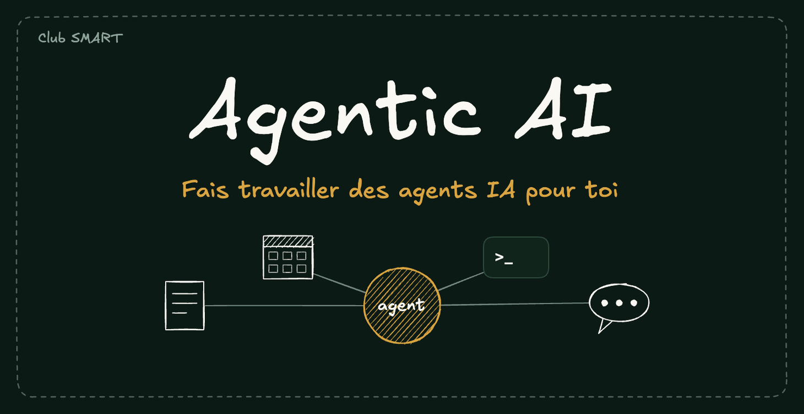

# Agentic AI

Classroom du Club SMART sur Skool, créée le 2026-10-23, en brouillon : https://www.skool.com/club-smart/classroom/17480787

Couverture : `couverture.png` (1460 x 752), source modifiable `couverture.excalidraw`.

## Modules

1. [Économiser tes tokens](../economiser-tes-tokens/economiser-tes-tokens.md) : 22 leçons, chacune avec son schéma.
