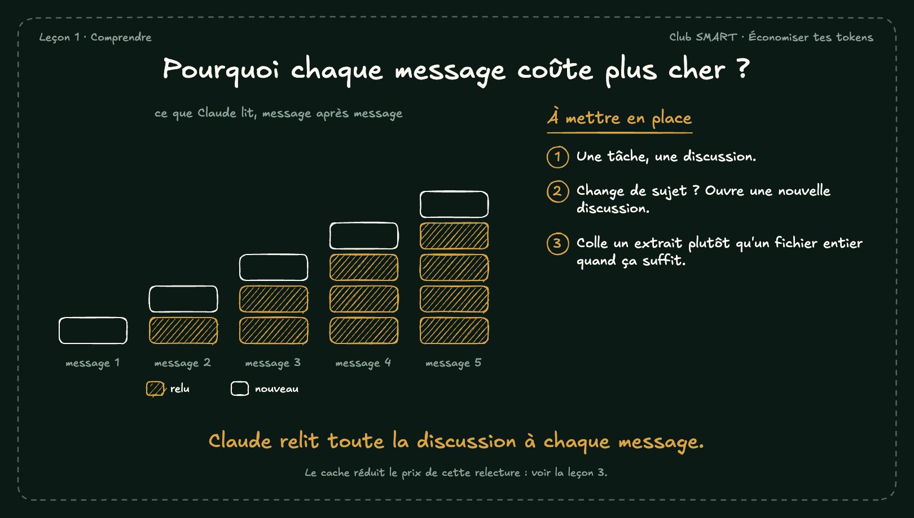

# Pourquoi chaque message coûte plus cher ?

Claude ne garde rien d'un message à l'autre. À chaque message, Claude Code renvoie tout : les consignes, ton projet, chaque message et chaque résultat d'outil. Plus la discussion grandit, plus chaque message coûte.

## À mettre en place

1. Une tâche, une discussion.
2. Change de sujet ? Ouvre une nouvelle discussion.
3. Colle un extrait plutôt qu'un fichier entier quand ça suffit.

**À retenir :** Claude relit toute la discussion à chaque message.

*Note : Le cache réduit le prix de cette relecture : voir la leçon 3.*
