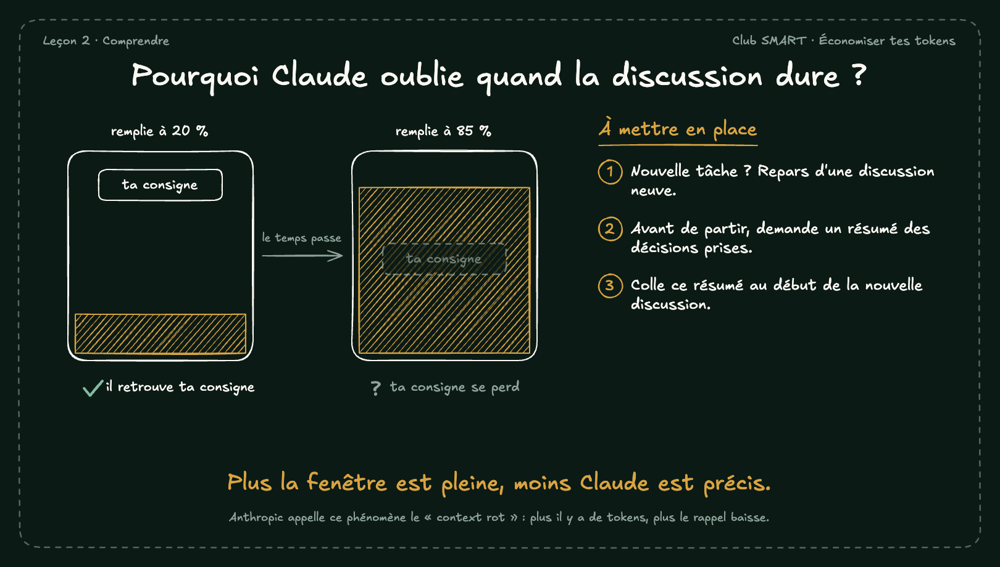

# Pourquoi Claude oublie quand la discussion dure ?

La fenêtre de contexte des modèles Claude 5.5 tient un million de tokens. Mais plus elle se remplit, moins Claude retrouve bien ce qu'elle contient.

## À mettre en place

1. Nouvelle tâche ? Repars d'une discussion neuve.
2. Avant de partir, demande un résumé des décisions prises.
3. Colle ce résumé au début de la nouvelle discussion.

**À retenir :** Plus la fenêtre est pleine, moins Claude est précis.

*Note : Anthropic appelle ce phénomène le « context rot » : plus il y a de tokens, plus le rappel baisse.*
