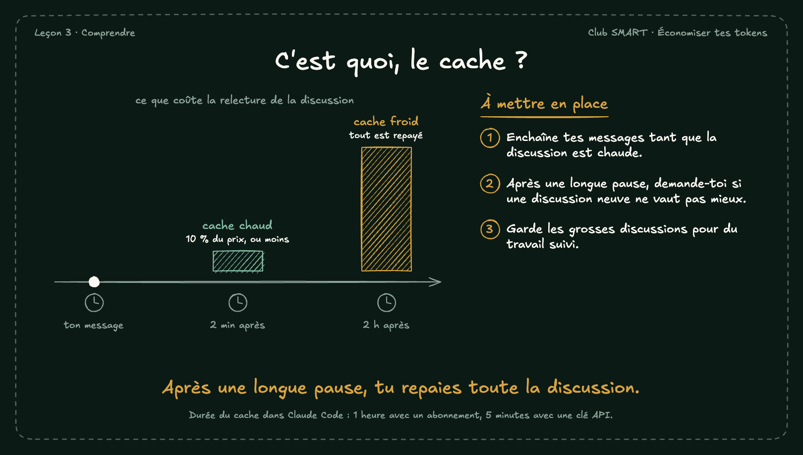

# C'est quoi, le cache ?

Le cache garde la partie de la discussion déjà lue. Tant qu'il est chaud, la relecture coûte une petite partie du prix normal. Après une pause trop longue, il refroidit : le message suivant relit tout au prix fort.

## À mettre en place

1. Enchaîne tes messages tant que la discussion est chaude.
2. Après une longue pause, demande-toi si une discussion neuve ne vaut pas mieux.
3. Garde les grosses discussions pour du travail suivi.

**À retenir :** Après une longue pause, tu repaies toute la discussion.

*Note : Durée du cache dans Claude Code : 1 heure avec un abonnement, 5 minutes avec une clé API.*
