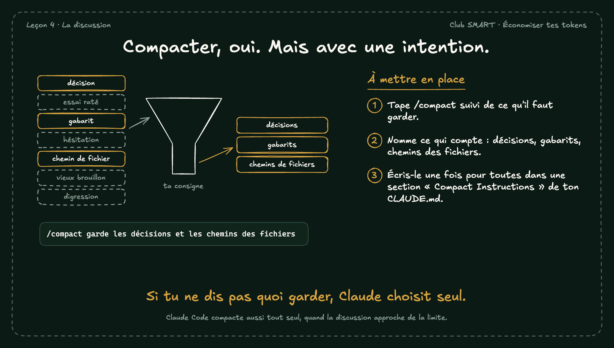

# Compacter, oui. Mais avec une intention.

Quand la discussion approche de la limite, Claude Code la résume tout seul et choisit ce qu'il garde. Avec /compact suivi d'une consigne, c'est toi qui choisis.

## À mettre en place

1. Tape /compact suivi de ce qu'il faut garder.
2. Nomme ce qui compte : décisions, gabarits, chemins des fichiers.
3. Écris-le une fois pour toutes dans une section « Compact Instructions » de ton CLAUDE.md.

**À retenir :** Si tu ne dis pas quoi garder, Claude choisit seul.

*Note : Claude Code compacte aussi tout seul, quand la discussion approche de la limite.*
