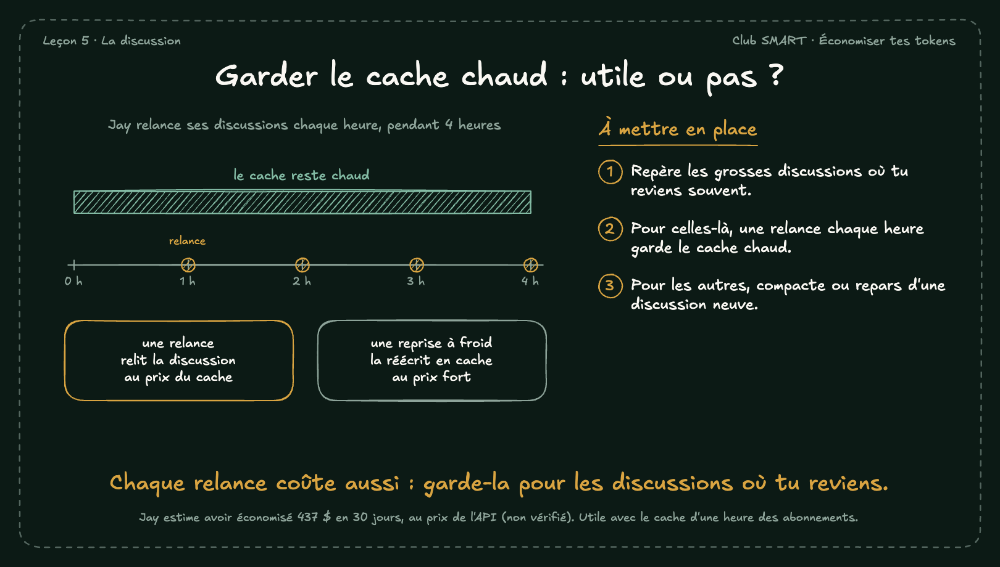

# Garder le cache chaud : utile ou pas ?

Jay relance ses grosses discussions chaque heure pour que le cache ne refroidisse pas. Une relance relit la discussion au prix du cache. Une reprise à froid la réécrit en cache, au prix fort. Ça vaut le coup seulement si tu reviens vraiment dans la discussion.

## À mettre en place

1. Repère les grosses discussions où tu reviens souvent.
2. Pour celles-là, une relance chaque heure garde le cache chaud.
3. Pour les autres, compacte ou repars d'une discussion neuve.

**À retenir :** Chaque relance coûte aussi : garde-la pour les discussions où tu reviens.

*Note : Jay estime avoir économisé 437 $ en 30 jours, au prix de l'API (non vérifié). Utile avec le cache d'une heure des abonnements.*
