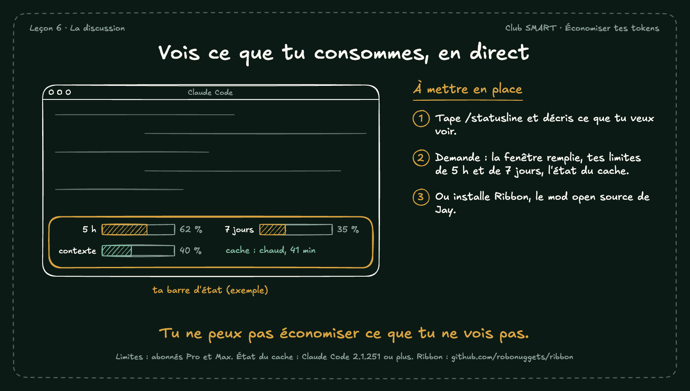

# Vois ce que tu consommes, en direct

La barre d'état de Claude Code peut afficher le remplissage de la fenêtre, tes limites de 5 heures et de 7 jours, et l'état du cache. Tu vois tout de suite quand une discussion coûte cher.

## À mettre en place

1. Tape /statusline et décris ce que tu veux voir.
2. Demande : la fenêtre remplie, tes limites de 5 h et de 7 jours, l'état du cache.
3. Ou installe Ribbon, le mod open source de Jay.

**À retenir :** Tu ne peux pas économiser ce que tu ne vois pas.

*Note : Limites : abonnés Pro et Max. État du cache : Claude Code 2.1.251 ou plus. Ribbon : github.com/robonuggets/ribbon*
