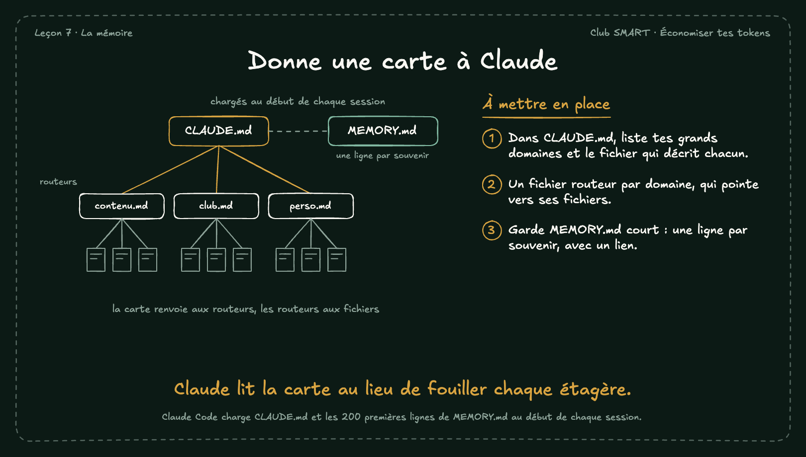

# Donne une carte à Claude

Au début de chaque session, Claude Code lit CLAUDE.md et le début de MEMORY.md. Si ces fichiers servent de carte, Claude sait où chercher sans tout parcourir.

## À mettre en place

1. Dans CLAUDE.md, liste tes grands domaines et le fichier qui décrit chacun.
2. Un fichier routeur par domaine, qui pointe vers ses fichiers.
3. Garde MEMORY.md court : une ligne par souvenir, avec un lien.

**À retenir :** Claude lit la carte au lieu de fouiller chaque étagère.

*Note : Claude Code charge CLAUDE.md et les 200 premières lignes de MEMORY.md au début de chaque session.*
