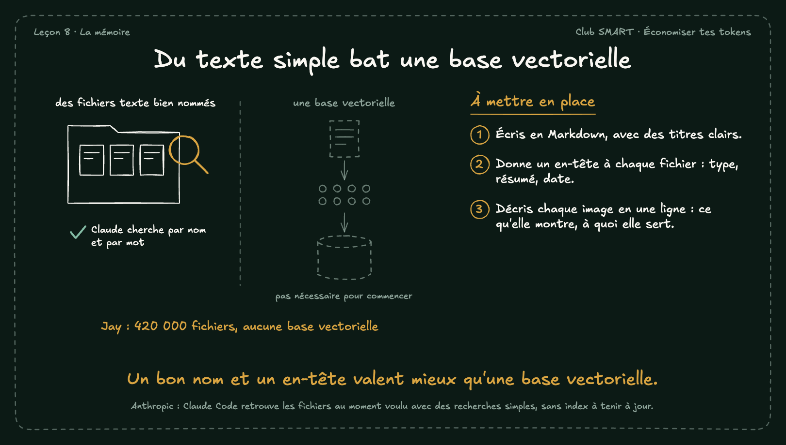

# Du texte simple bat une base vectorielle

Pas besoin d'une base vectorielle pour retrouver tes fichiers. Claude Code cherche par nom et par mot. Des noms clairs et un en-tête par fichier suffisent.

## À mettre en place

1. Écris en Markdown, avec des titres clairs.
2. Donne un en-tête à chaque fichier : type, résumé, date.
3. Décris chaque image en une ligne : ce qu'elle montre, à quoi elle sert.

**À retenir :** Un bon nom et un en-tête valent mieux qu'une base vectorielle.

*Note : Anthropic : Claude Code retrouve les fichiers au moment voulu avec des recherches simples, sans index à tenir à jour.*
