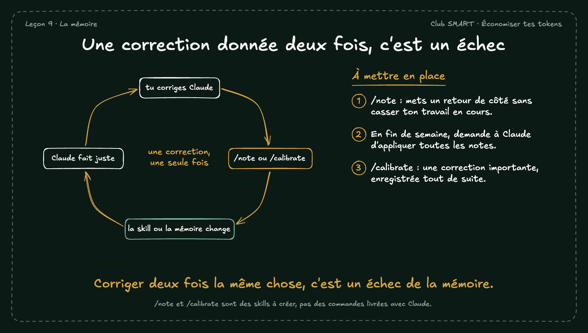

# Une correction donnée deux fois, c'est un échec

Chaque correction doit finir dans une skill ou dans la mémoire, sinon tu la redonneras. Jay utilise deux skills : /note pour mettre un retour de côté, /calibrate pour une correction importante.

## À mettre en place

1. /note : mets un retour de côté sans casser ton travail en cours.
2. En fin de semaine, demande à Claude d'appliquer toutes les notes.
3. /calibrate : une correction importante, enregistrée tout de suite.

**À retenir :** Corriger deux fois la même chose, c'est un échec de la mémoire.

*Note : /note et /calibrate sont des skills à créer, pas des commandes livrées avec Claude.*
