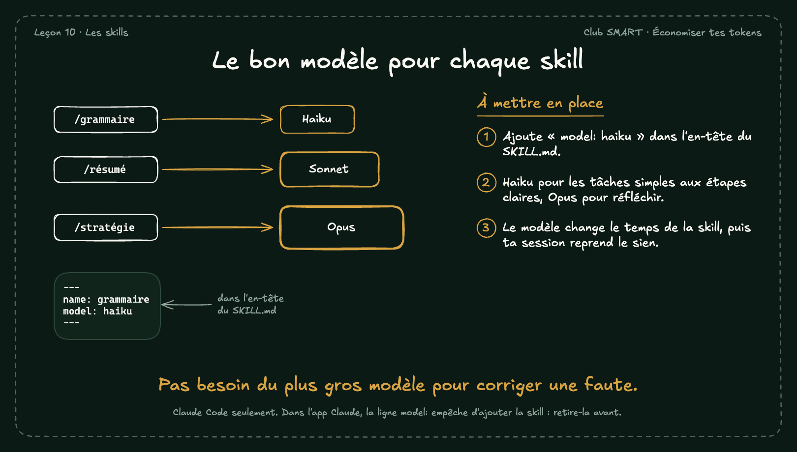

# Le bon modèle pour chaque skill

Une skill peut choisir son modèle. Une skill simple, comme une relecture d'orthographe, tourne très bien sur Haiku, plus rapide et moins cher.

## À mettre en place

1. Ajoute « model: haiku » dans l'en-tête du SKILL.md.
2. Haiku pour les tâches simples aux étapes claires, Opus pour réfléchir.
3. Le modèle change le temps de la skill, puis ta session reprend le sien.

**À retenir :** Pas besoin du plus gros modèle pour corriger une faute.

*Note : Claude Code seulement. Dans l'app Claude, la ligne model: empêche d'ajouter la skill : retire-la avant.*
