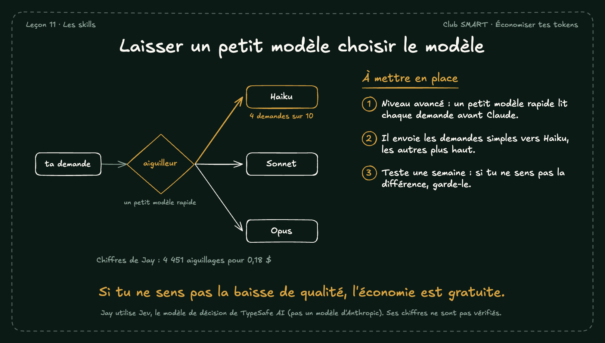

# Laisser un petit modèle choisir le modèle

Jay va plus loin : un petit modèle rapide lit chaque demande et choisit le modèle qui va la traiter. Selon lui, environ 4 demandes sur 10 partent vers Haiku, sans perte de qualité ressentie.

## À mettre en place

1. Niveau avancé : un petit modèle rapide lit chaque demande avant Claude.
2. Il envoie les demandes simples vers Haiku, les autres plus haut.
3. Teste une semaine : si tu ne sens pas la différence, garde-le.

**À retenir :** Si tu ne sens pas la baisse de qualité, l'économie est gratuite.

*Note : Jay utilise Jev, le modèle de décision de TypeSafe AI (pas un modèle d'Anthropic). Ses chiffres ne sont pas vérifiés.*
