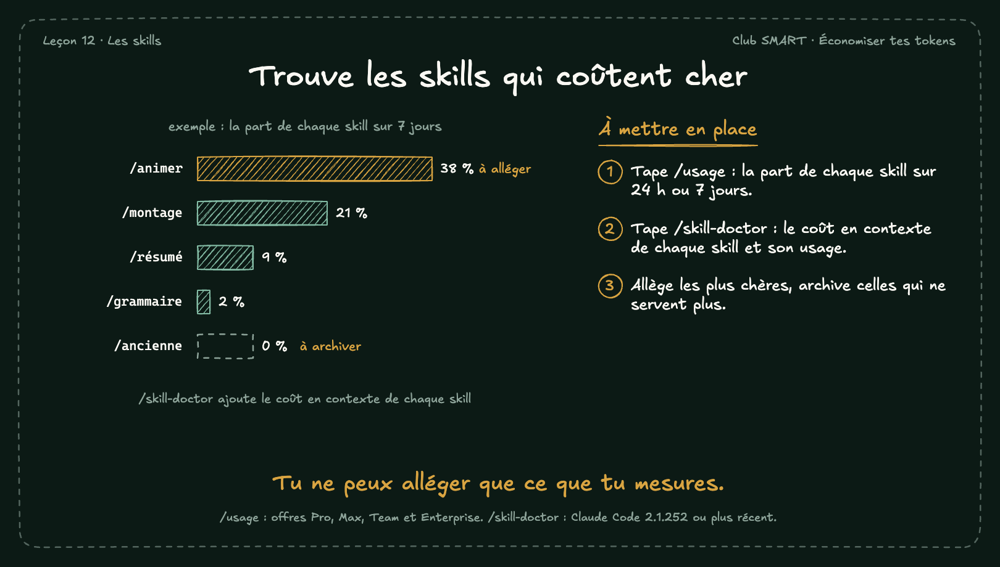

# Trouve les skills qui coûtent cher

Claude Code montre quelles skills consomment le plus. Pas besoin de construire un tableau de bord.

## À mettre en place

1. Tape /usage : la part de chaque skill sur 24 h ou 7 jours.
2. Tape /skill-doctor : le coût en contexte de chaque skill et son usage.
3. Allège les plus chères, archive celles qui ne servent plus.

**À retenir :** Tu ne peux alléger que ce que tu mesures.

*Note : /usage : offres Pro, Max, Team et Enterprise. /skill-doctor : Claude Code 2.1.252 ou plus récent.*
