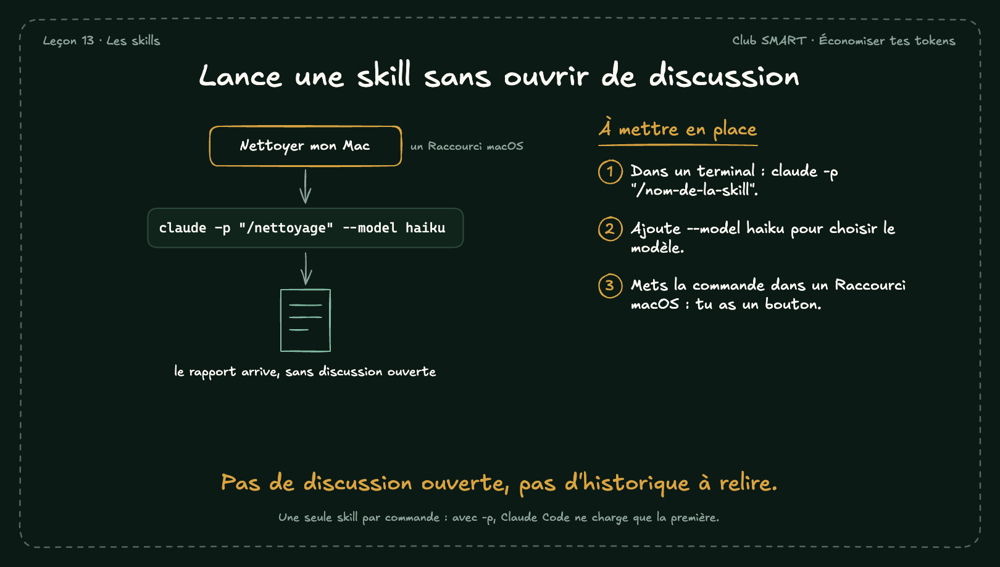

# Lance une skill sans ouvrir de discussion

Une skill peut se lancer depuis un terminal, sans ouvrir de discussion. Avec un Raccourci macOS, ça devient un bouton.

## À mettre en place

1. Dans un terminal : claude -p "/nom-de-la-skill".
2. Ajoute --model haiku pour choisir le modèle.
3. Mets la commande dans un Raccourci macOS : tu as un bouton.

**À retenir :** Pas de discussion ouverte, pas d'historique à relire.

*Note : Une seule skill par commande : avec -p, Claude Code ne charge que la première.*
