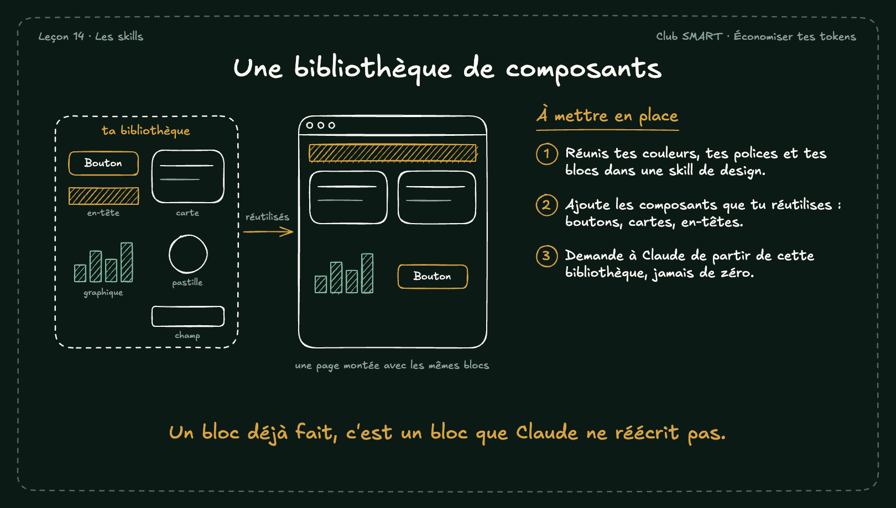

# Une bibliothèque de composants

Si Claude doit recréer chaque bouton et chaque carte, il dépense des tokens à chaque fois. Une bibliothèque de composants lui donne des blocs déjà faits, et tes pages restent cohérentes.

## À mettre en place

1. Réunis tes couleurs, tes polices et tes blocs dans une skill de design.
2. Ajoute les composants que tu réutilises : boutons, cartes, en-têtes.
3. Demande à Claude de partir de cette bibliothèque, jamais de zéro.

**À retenir :** Un bloc déjà fait, c'est un bloc que Claude ne réécrit pas.
