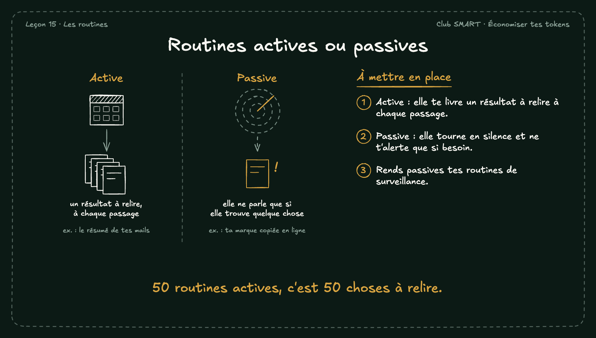

# Routines actives ou passives

Une routine active te livre un résultat à chaque passage. Une routine passive ne te dérange que si elle trouve quelque chose. Plus tu as de routines, plus les passives comptent.

## À mettre en place

1. Active : elle te livre un résultat à relire à chaque passage.
2. Passive : elle tourne en silence et ne t'alerte que si besoin.
3. Rends passives tes routines de surveillance.

**À retenir :** 50 routines actives, c'est 50 choses à relire.
