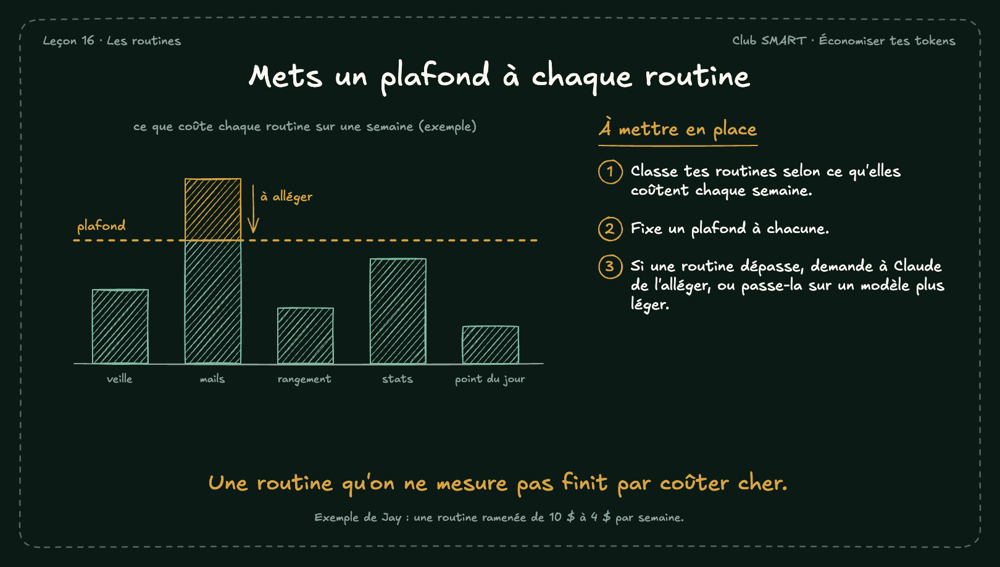

# Mets un plafond à chaque routine

Chaque tâche planifiée consomme ton usage, comme une discussion. Un plafond par routine évite qu'une seule routine mange ta semaine.

## À mettre en place

1. Classe tes routines selon ce qu'elles coûtent chaque semaine.
2. Fixe un plafond à chacune.
3. Si une routine dépasse, demande à Claude de l'alléger, ou passe-la sur un modèle plus léger.

**À retenir :** Une routine qu'on ne mesure pas finit par coûter cher.

*Note : Exemple de Jay : une routine ramenée de 10 $ à 4 $ par semaine.*
