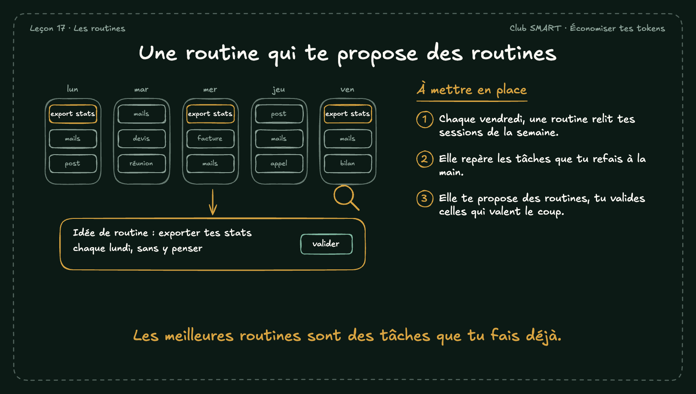

# Une routine qui te propose des routines

Les meilleures routines sont souvent des tâches que tu fais déjà à la main, sans t'en rendre compte. Une routine peut les repérer pour toi.

## À mettre en place

1. Chaque vendredi, une routine relit tes sessions de la semaine.
2. Elle repère les tâches que tu refais à la main.
3. Elle te propose des routines, tu valides celles qui valent le coup.

**À retenir :** Les meilleures routines sont des tâches que tu fais déjà.
