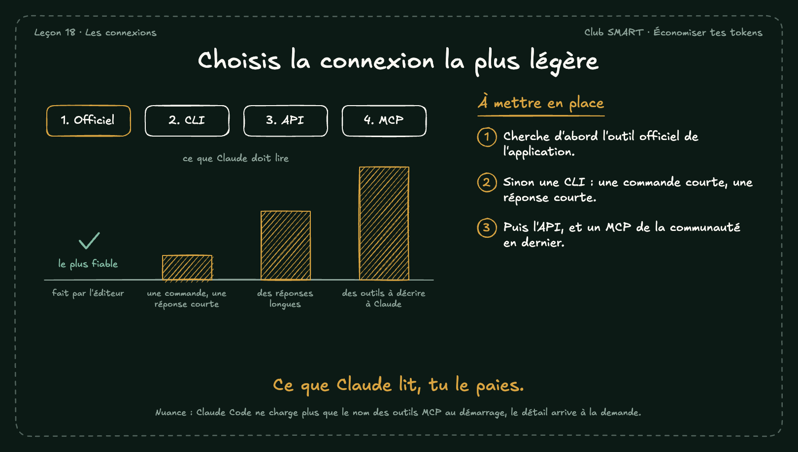

# Choisis la connexion la plus légère

Pour brancher Claude sur un outil, il existe plusieurs chemins. Plus la réponse de l'outil est longue, plus Claude lit, et plus tu paies.

## À mettre en place

1. Cherche d'abord l'outil officiel de l'application.
2. Sinon une CLI : une commande courte, une réponse courte.
3. Puis l'API, et un MCP de la communauté en dernier.

**À retenir :** Ce que Claude lit, tu le paies.

*Note : Nuance : Claude Code ne charge plus que le nom des outils MCP au démarrage, le détail arrive à la demande.*
