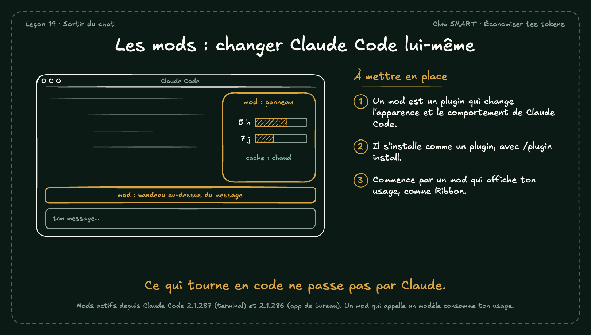

# Les mods : changer Claude Code lui-même

Un mod change l'apparence ou le comportement de Claude Code : un panneau, un bandeau, une commande. Il tourne en code, sans passer par Claude, sauf s'il appelle un modèle.

## À mettre en place

1. Un mod est un plugin qui change l'apparence et le comportement de Claude Code.
2. Il s'installe comme un plugin, avec /plugin install.
3. Commence par un mod qui affiche ton usage, comme Ribbon.

**À retenir :** Ce qui tourne en code ne passe pas par Claude.

*Note : Mods actifs depuis Claude Code 2.1.287 (terminal) et 2.1.286 (app de bureau). Un mod qui appelle un modèle consomme ton usage.*
