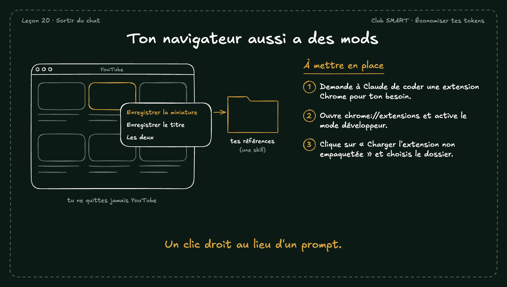

# Ton navigateur aussi a des mods

Chrome a des mods depuis longtemps : les extensions. Claude peut en coder une pour toi, par exemple pour enregistrer une miniature YouTube dans tes références en un clic droit.

## À mettre en place

1. Demande à Claude de coder une extension Chrome pour ton besoin.
2. Ouvre chrome://extensions et active le mode développeur.
3. Clique sur « Charger l'extension non empaquetée » et choisis le dossier.

**À retenir :** Un clic droit au lieu d'un prompt.
