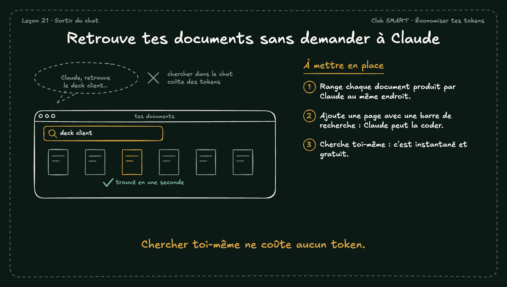

# Retrouve tes documents sans demander à Claude

Demander à Claude de retrouver un document coûte des tokens. Une page qui range tous tes documents, avec une barre de recherche, te le donne en une seconde.

## À mettre en place

1. Range chaque document produit par Claude au même endroit.
2. Ajoute une page avec une barre de recherche : Claude peut la coder.
3. Cherche toi-même : c'est instantané et gratuit.

**À retenir :** Chercher toi-même ne coûte aucun token.
