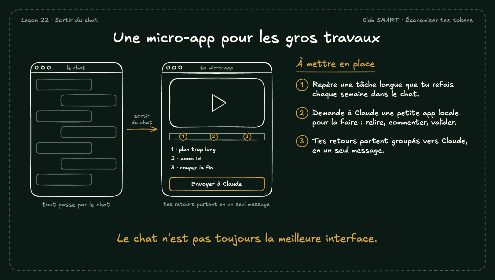

# Une micro-app pour les gros travaux

Pour une tâche longue et répétée, le chat n'est pas toujours le meilleur outil. Une petite app locale te laisse relire et commenter, puis envoyer tous tes retours en un seul message.

## À mettre en place

1. Repère une tâche longue que tu refais chaque semaine dans le chat.
2. Demande à Claude une petite app locale pour la faire : relire, commenter, valider.
3. Tes retours partent groupés vers Claude, en un seul message.

**À retenir :** Le chat n'est pas toujours la meilleure interface.
