# Économiser tes tokens

Un module de 22 leçons pour le Club SMART. Chaque leçon tient en une image et un court texte à coller dans Skool. L'image PNG va dans la leçon ; le fichier `.excalidraw` du même nom reste la source modifiable (excalidraw.com, menu Ouvrir).

Les images sont générées par un script, en charte vert pin (rôle éditorial). Pour changer un texte, modifie le `.excalidraw` ou demande à Claude de régénérer la leçon.

## Comprendre

### Leçon 1 · Pourquoi chaque message coûte plus cher ?

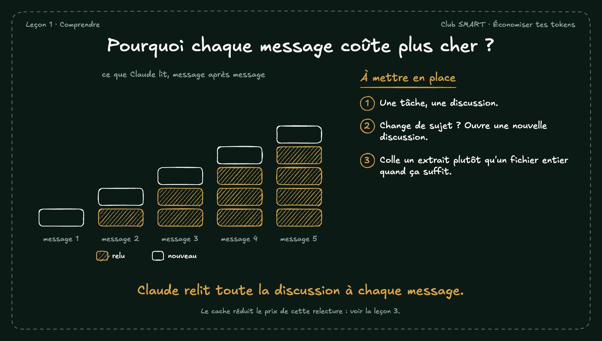

Claude ne garde rien d'un message à l'autre. À chaque message, Claude Code renvoie tout : les consignes, ton projet, chaque message et chaque résultat d'outil. Plus la discussion grandit, plus chaque message coûte.

À mettre en place :

1. Une tâche, une discussion.
2. Change de sujet ? Ouvre une nouvelle discussion.
3. Colle un extrait plutôt qu'un fichier entier quand ça suffit.

À retenir : Claude relit toute la discussion à chaque message.

Note : Le cache réduit le prix de cette relecture : voir la leçon 3.

### Leçon 2 · Pourquoi Claude oublie dans les longues discussions ?

La fenêtre de contexte des modèles Claude 5.5 tient un million de tokens. Mais plus elle se remplit, moins Claude retrouve bien ce qu'elle contient.

À mettre en place :

1. Nouvelle tâche ? Repars d'une discussion neuve.
2. Avant de partir, demande un résumé des décisions prises.
3. Colle ce résumé au début de la nouvelle discussion.

À retenir : Plus la fenêtre est pleine, moins Claude est précis.

Note : Anthropic appelle ce phénomène le « context rot » : plus il y a de tokens, plus le rappel baisse.

### Leçon 3 · C'est quoi, le cache ?

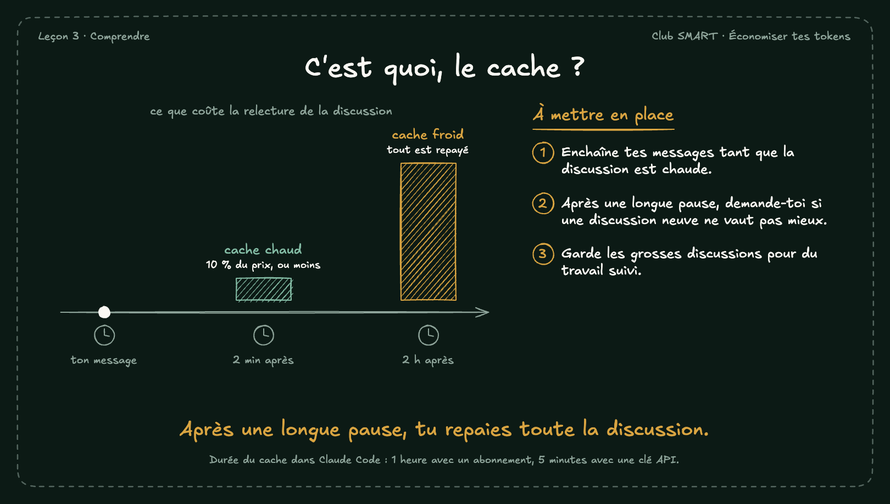

Le cache garde la partie de la discussion déjà lue. Tant qu'il est chaud, la relecture coûte une petite partie du prix normal. Après une pause trop longue, il refroidit : le message suivant relit tout au prix fort.

À mettre en place :

1. Enchaîne tes messages tant que la discussion est chaude.
2. Après une longue pause, demande-toi si une discussion neuve ne vaut pas mieux.
3. Garde les grosses discussions pour du travail suivi.

À retenir : Après une longue pause, tu repaies toute la discussion.

Note : Durée du cache dans Claude Code : 1 heure avec un abonnement, 5 minutes avec une clé API.

## La discussion

### Leçon 4 · Compacter, oui. Mais avec une intention.

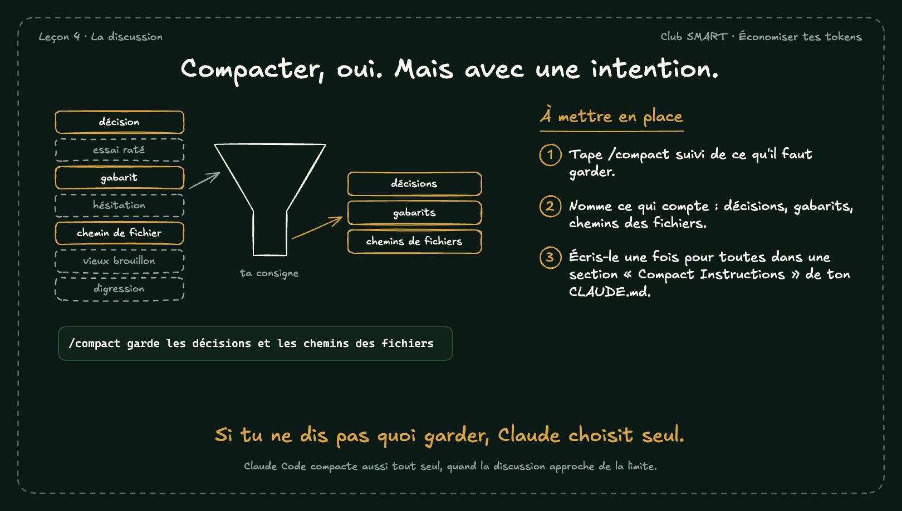

Quand la discussion approche de la limite, Claude Code la résume tout seul et choisit ce qu'il garde. Avec /compact suivi d'une consigne, c'est toi qui choisis.

À mettre en place :

1. Tape /compact suivi de ce qu'il faut garder.
2. Nomme ce qui compte : décisions, gabarits, chemins des fichiers.
3. Écris-le une fois pour toutes dans une section « Compact Instructions » de ton CLAUDE.md.

À retenir : Si tu ne dis pas quoi garder, Claude choisit seul.

Note : Claude Code compacte aussi tout seul, quand la discussion approche de la limite.

### Leçon 5 · Garder le cache chaud : utile ou pas ?

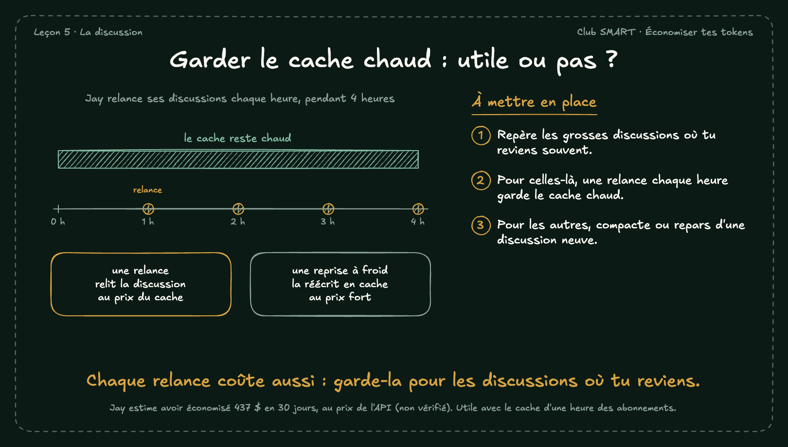

Jay relance ses grosses discussions chaque heure pour que le cache ne refroidisse pas. Une relance relit la discussion au prix du cache. Une reprise à froid la réécrit en cache, au prix fort. Ça vaut le coup seulement si tu reviens vraiment dans la discussion.

À mettre en place :

1. Repère les grosses discussions où tu reviens souvent.
2. Pour celles-là, une relance chaque heure garde le cache chaud.
3. Pour les autres, compacte ou repars d'une discussion neuve.

À retenir : Chaque relance coûte aussi : garde-la pour les discussions où tu reviens.

Note : Jay estime avoir économisé 437 $ en 30 jours, au prix de l'API (non vérifié). Utile avec le cache d'une heure des abonnements.

### Leçon 6 · Vois ce que tu consommes, en direct

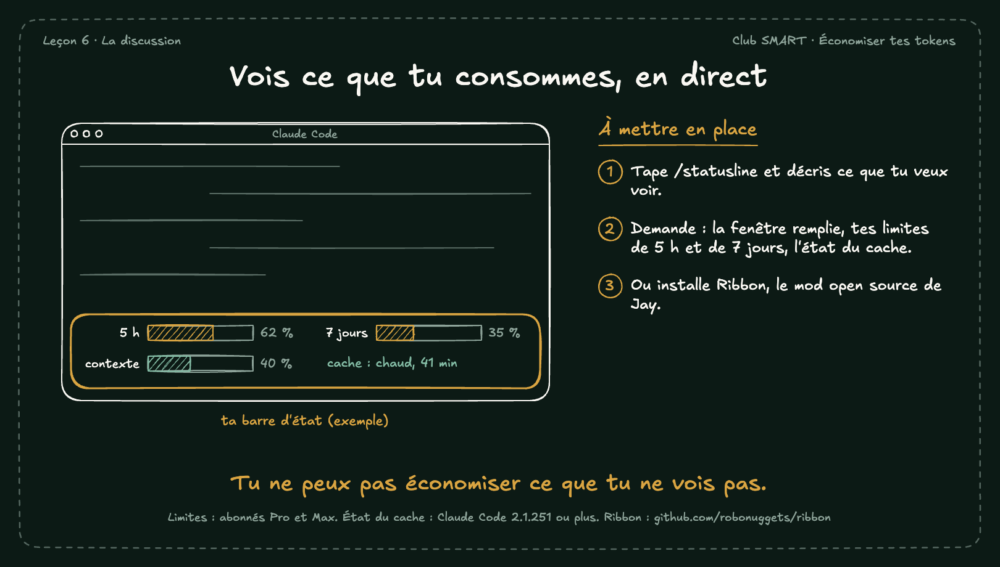

La barre d'état de Claude Code peut afficher le remplissage de la fenêtre, tes limites de 5 heures et de 7 jours, et l'état du cache. Tu vois tout de suite quand une discussion coûte cher.

À mettre en place :

1. Tape /statusline et décris ce que tu veux voir.
2. Demande : la fenêtre remplie, tes limites de 5 h et de 7 jours, l'état du cache.
3. Ou installe Ribbon, le mod open source de Jay.

À retenir : Tu ne peux pas économiser ce que tu ne vois pas.

Note : Limites : abonnés Pro et Max. État du cache : Claude Code 2.1.251 ou plus. Ribbon : github.com/robonuggets/ribbon

## La mémoire

### Leçon 7 · Donne une carte à Claude

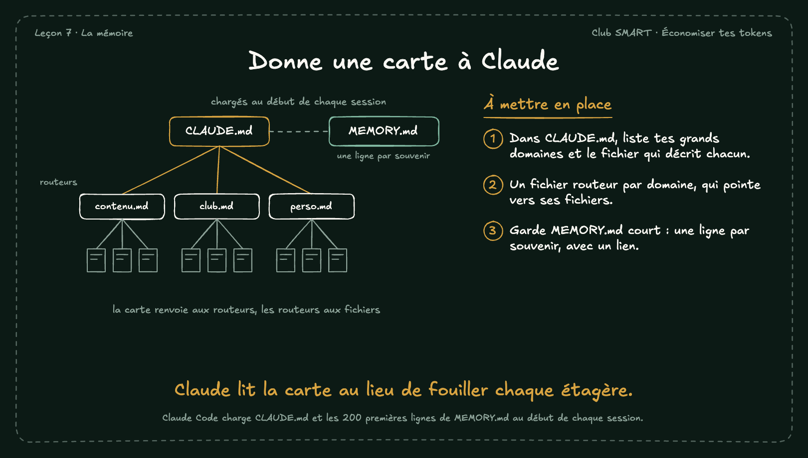

Au début de chaque session, Claude Code lit CLAUDE.md et le début de MEMORY.md. Si ces fichiers servent de carte, Claude sait où chercher sans tout parcourir.

À mettre en place :

1. Dans CLAUDE.md, liste tes grands domaines et le fichier qui décrit chacun.
2. Un fichier routeur par domaine, qui pointe vers ses fichiers.
3. Garde MEMORY.md court : une ligne par souvenir, avec un lien.

À retenir : Claude lit la carte au lieu de fouiller chaque étagère.

Note : Claude Code charge CLAUDE.md et les 200 premières lignes de MEMORY.md au début de chaque session.

### Leçon 8 · Du texte simple bat une base vectorielle

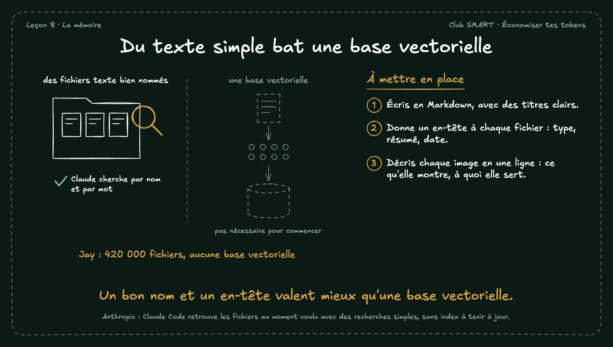

Pas besoin d'une base vectorielle pour retrouver tes fichiers. Claude Code cherche par nom et par mot. Des noms clairs et un en-tête par fichier suffisent.

À mettre en place :

1. Écris en Markdown, avec des titres clairs.
2. Donne un en-tête à chaque fichier : type, résumé, date.
3. Décris chaque image en une ligne : ce qu'elle montre, à quoi elle sert.

À retenir : Un bon nom et un en-tête valent mieux qu'une base vectorielle.

Note : Anthropic : Claude Code retrouve les fichiers au moment voulu avec des recherches simples, sans index à tenir à jour.

### Leçon 9 · Une correction donnée deux fois, c'est un échec

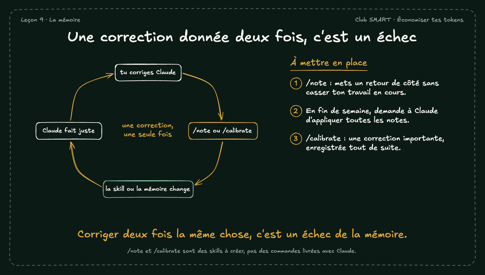

Chaque correction doit finir dans une skill ou dans la mémoire, sinon tu la redonneras. Jay utilise deux skills : /note pour mettre un retour de côté, /calibrate pour une correction importante.

À mettre en place :

1. /note : mets un retour de côté sans casser ton travail en cours.
2. En fin de semaine, demande à Claude d'appliquer toutes les notes.
3. /calibrate : une correction importante, enregistrée tout de suite.

À retenir : Corriger deux fois la même chose, c'est un échec de la mémoire.

Note : /note et /calibrate sont des skills à créer, pas des commandes livrées avec Claude.

## Les skills

### Leçon 10 · Le bon modèle pour chaque skill

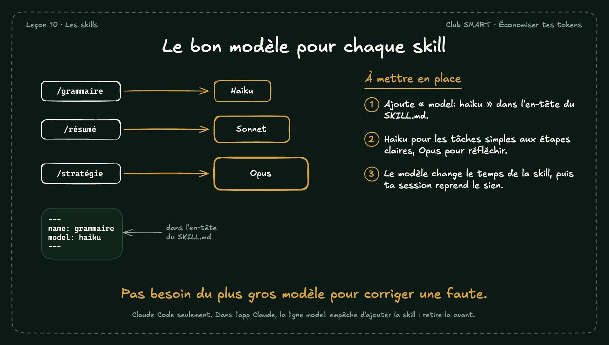

Une skill peut choisir son modèle. Une skill simple, comme une relecture d'orthographe, tourne très bien sur Haiku, plus rapide et moins cher.

À mettre en place :

1. Ajoute « model: haiku » dans l'en-tête du SKILL.md.
2. Haiku pour les tâches simples aux étapes claires, Opus pour réfléchir.
3. Le modèle change le temps de la skill, puis ta session reprend le sien.

À retenir : Pas besoin du plus gros modèle pour corriger une faute.

Note : Claude Code seulement. Dans l'app Claude, la ligne model: empêche d'ajouter la skill : retire-la avant.

### Leçon 11 · Laisser un petit modèle choisir le modèle

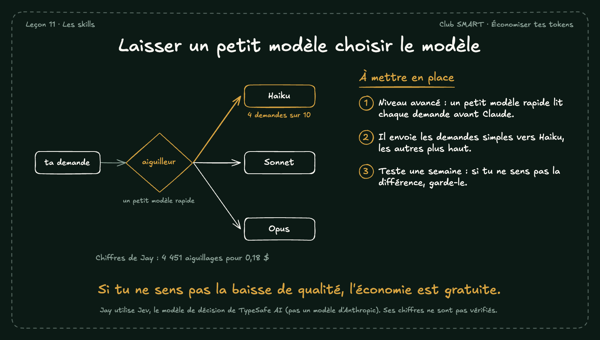

Jay va plus loin : un petit modèle rapide lit chaque demande et choisit le modèle qui va la traiter. Selon lui, environ 4 demandes sur 10 partent vers Haiku, sans perte de qualité ressentie.

À mettre en place :

1. Niveau avancé : un petit modèle rapide lit chaque demande avant Claude.
2. Il envoie les demandes simples vers Haiku, les autres plus haut.
3. Teste une semaine : si tu ne sens pas la différence, garde-le.

À retenir : Si tu ne sens pas la baisse de qualité, l'économie est gratuite.

Note : Jay utilise Jev, le modèle de décision de TypeSafe AI (pas un modèle d'Anthropic). Ses chiffres ne sont pas vérifiés.

### Leçon 12 · Trouve les skills qui coûtent cher

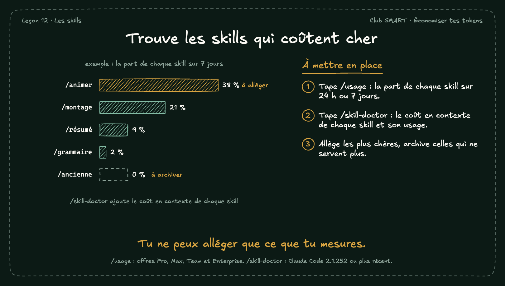

Claude Code montre quelles skills consomment le plus. Pas besoin de construire un tableau de bord.

À mettre en place :

1. Tape /usage : la part de chaque skill sur 24 h ou 7 jours.
2. Tape /skill-doctor : le coût en contexte de chaque skill et son usage.
3. Allège les plus chères, archive celles qui ne servent plus.

À retenir : Tu ne peux alléger que ce que tu mesures.

Note : /usage : offres Pro, Max, Team et Enterprise. /skill-doctor : Claude Code 2.1.252 ou plus récent.

### Leçon 13 · Lance une skill sans ouvrir de discussion

Une skill peut se lancer depuis un terminal, sans ouvrir de discussion. Avec un Raccourci macOS, ça devient un bouton.

À mettre en place :

1. Dans un terminal : claude -p "/nom-de-la-skill".
2. Ajoute --model haiku pour choisir le modèle.
3. Mets la commande dans un Raccourci macOS : tu as un bouton.

À retenir : Pas de discussion ouverte, pas d'historique à relire.

Note : Une seule skill par commande : avec -p, Claude Code ne charge que la première.

### Leçon 14 · Une bibliothèque de composants

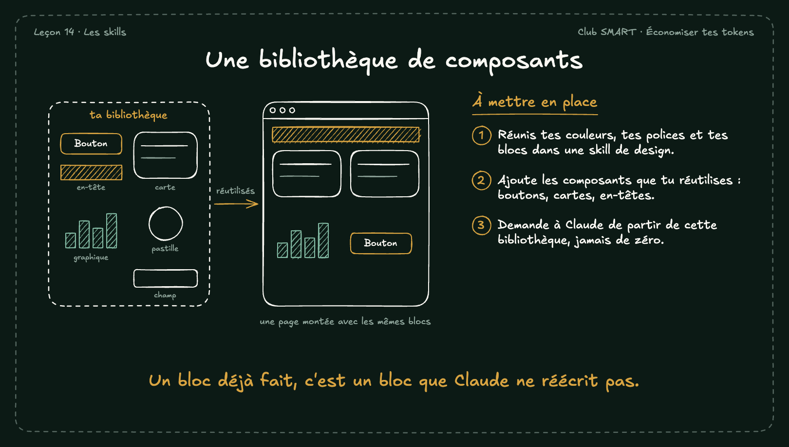

Si Claude doit recréer chaque bouton et chaque carte, il dépense des tokens à chaque fois. Une bibliothèque de composants lui donne des blocs déjà faits, et tes pages restent cohérentes.

À mettre en place :

1. Réunis tes couleurs, tes polices et tes blocs dans une skill de design.
2. Ajoute les composants que tu réutilises : boutons, cartes, en-têtes.
3. Demande à Claude de partir de cette bibliothèque, jamais de zéro.

À retenir : Un bloc déjà fait, c'est un bloc que Claude ne réécrit pas.

## Les routines

### Leçon 15 · Routines actives ou passives

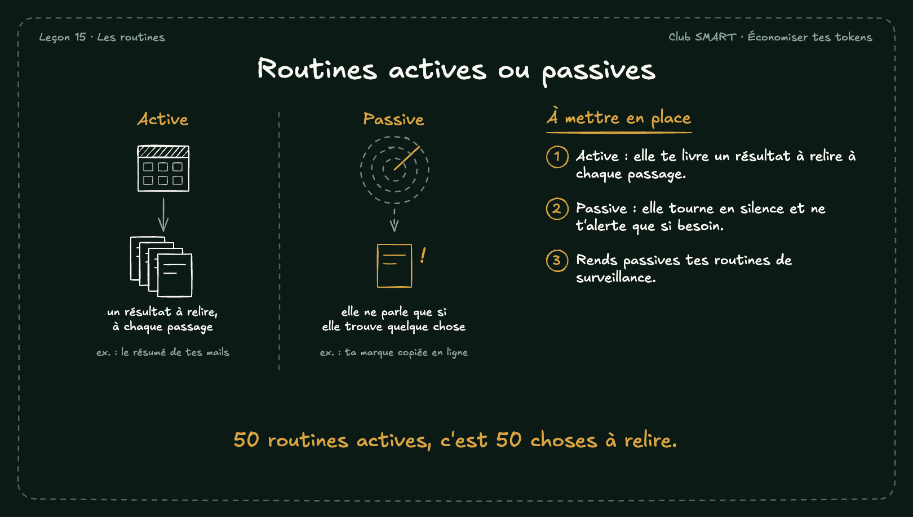

Une routine active te livre un résultat à chaque passage. Une routine passive ne te dérange que si elle trouve quelque chose. Plus tu as de routines, plus les passives comptent.

À mettre en place :

1. Active : elle te livre un résultat à relire à chaque passage.
2. Passive : elle tourne en silence et ne t'alerte que si besoin.
3. Rends passives tes routines de surveillance.

À retenir : 50 routines actives, c'est 50 choses à relire.

### Leçon 16 · Mets un plafond à chaque routine

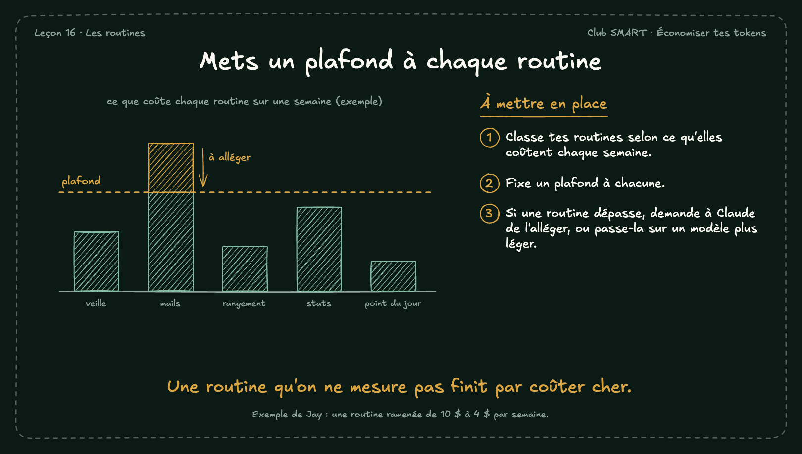

Chaque tâche planifiée consomme ton usage, comme une discussion. Un plafond par routine évite qu'une seule routine mange ta semaine.

À mettre en place :

1. Classe tes routines selon ce qu'elles coûtent chaque semaine.
2. Fixe un plafond à chacune.
3. Si une routine dépasse, demande à Claude de l'alléger, ou passe-la sur un modèle plus léger.

À retenir : Une routine qu'on ne mesure pas finit par coûter cher.

Note : Exemple de Jay : une routine ramenée de 10 $ à 4 $ par semaine.

### Leçon 17 · Une routine qui te propose des routines

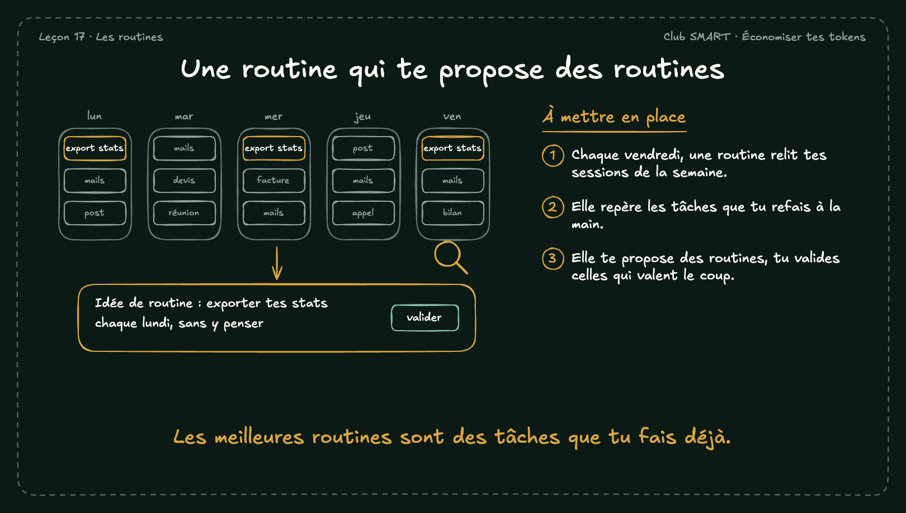

Les meilleures routines sont souvent des tâches que tu fais déjà à la main, sans t'en rendre compte. Une routine peut les repérer pour toi.

À mettre en place :

1. Chaque vendredi, une routine relit tes sessions de la semaine.
2. Elle repère les tâches que tu refais à la main.
3. Elle te propose des routines, tu valides celles qui valent le coup.

À retenir : Les meilleures routines sont des tâches que tu fais déjà.

## Les connexions

### Leçon 18 · Choisis la connexion la plus légère

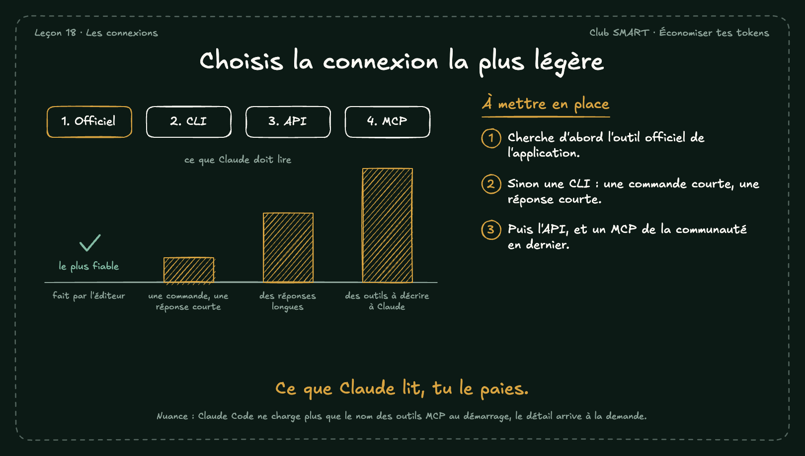

Pour brancher Claude sur un outil, il existe plusieurs chemins. Plus la réponse de l'outil est longue, plus Claude lit, et plus tu paies.

À mettre en place :

1. Cherche d'abord l'outil officiel de l'application.
2. Sinon une CLI : une commande courte, une réponse courte.
3. Puis l'API, et un MCP de la communauté en dernier.

À retenir : Ce que Claude lit, tu le paies.

Note : Nuance : Claude Code ne charge plus que le nom des outils MCP au démarrage, le détail arrive à la demande.

## Sortir du chat

### Leçon 19 · Les mods : changer Claude Code lui-même

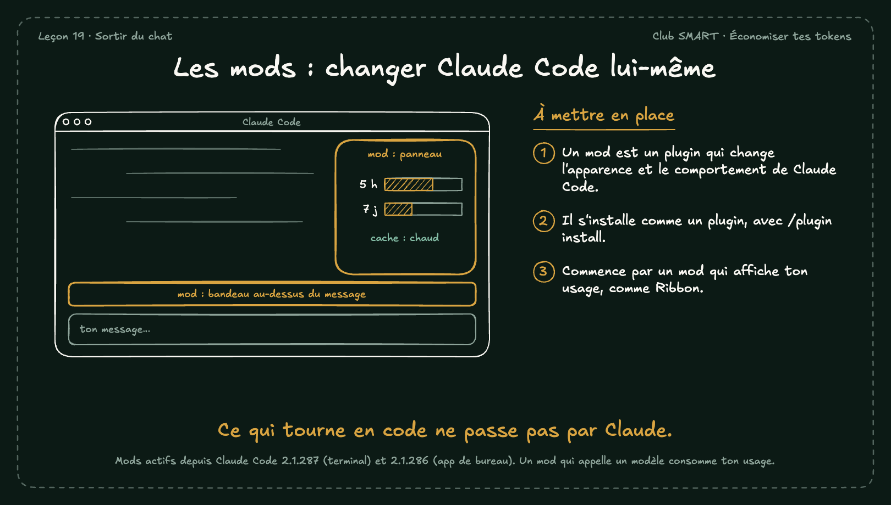

Un mod change l'apparence ou le comportement de Claude Code : un panneau, un bandeau, une commande. Il tourne en code, sans passer par Claude, sauf s'il appelle un modèle.

À mettre en place :

1. Un mod est un plugin qui change l'apparence et le comportement de Claude Code.
2. Il s'installe comme un plugin, avec /plugin install.
3. Commence par un mod qui affiche ton usage, comme Ribbon.

À retenir : Ce qui tourne en code ne passe pas par Claude.

Note : Mods actifs depuis Claude Code 2.1.287 (terminal) et 2.1.286 (app de bureau). Un mod qui appelle un modèle consomme ton usage.

### Leçon 20 · Ton navigateur aussi a des mods

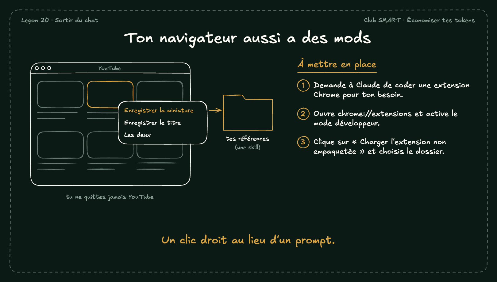

Chrome a des mods depuis longtemps : les extensions. Claude peut en coder une pour toi, par exemple pour enregistrer une miniature YouTube dans tes références en un clic droit.

À mettre en place :

1. Demande à Claude de coder une extension Chrome pour ton besoin.
2. Ouvre chrome://extensions et active le mode développeur.
3. Clique sur « Charger l'extension non empaquetée » et choisis le dossier.

À retenir : Un clic droit au lieu d'un prompt.

### Leçon 21 · Retrouve tes documents sans demander à Claude

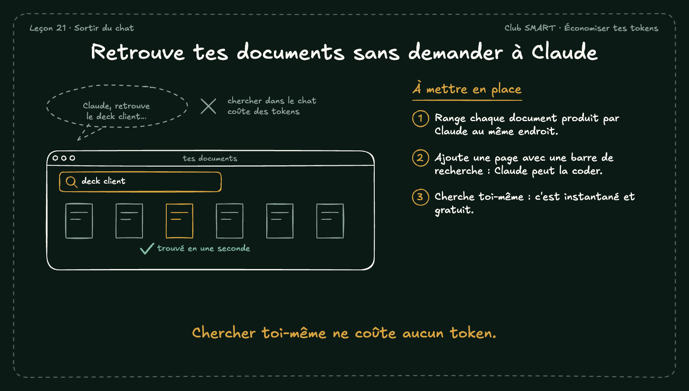

Demander à Claude de retrouver un document coûte des tokens. Une page qui range tous tes documents, avec une barre de recherche, te le donne en une seconde.

À mettre en place :

1. Range chaque document produit par Claude au même endroit.
2. Ajoute une page avec une barre de recherche : Claude peut la coder.
3. Cherche toi-même : c'est instantané et gratuit.

À retenir : Chercher toi-même ne coûte aucun token.

### Leçon 22 · Une micro-app pour les gros travaux

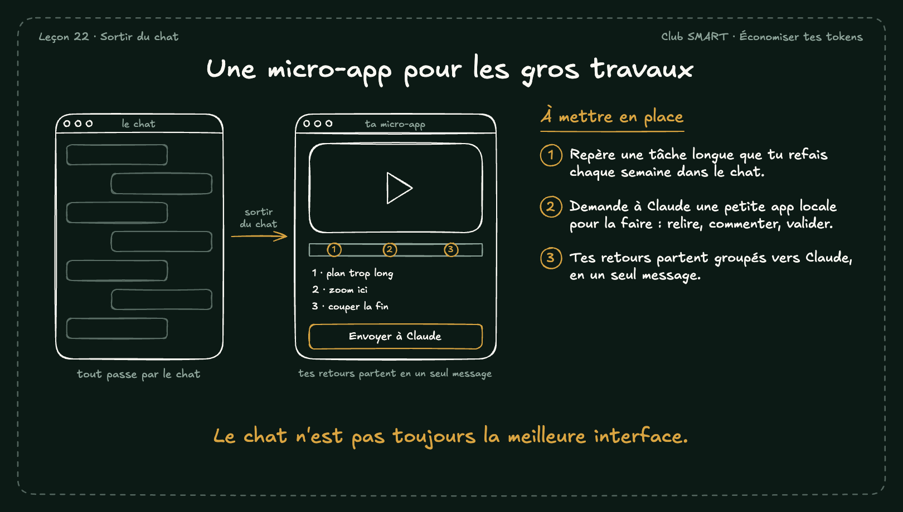

Pour une tâche longue et répétée, le chat n'est pas toujours le meilleur outil. Une petite app locale te laisse relire et commenter, puis envoyer tous tes retours en un seul message.

À mettre en place :

1. Repère une tâche longue que tu refais chaque semaine dans le chat.
2. Demande à Claude une petite app locale pour la faire : relire, commenter, valider.
3. Tes retours partent groupés vers Claude, en un seul message.

À retenir : Le chat n'est pas toujours la meilleure interface.

## Sources

- Jay E (RoboNuggets), « A NEW Agentic OS Standard for Claude 5.5 is here », publiée le 21 octobre 2026 : https://www.youtube.com/watch?v=s_1GPN-NXA0
- Faits techniques vérifiés le 23 octobre 2026 dans la documentation officielle :
  - cache et relecture : https://code.claude.com/docs/en/prompt-caching
  - context rot : https://platform.claude.com/docs/en/build-with-claude/context-windows
  - compaction et fichiers chargés : https://code.claude.com/docs/en/context-window et https://code.claude.com/docs/en/memory
  - recherche dans les fichiers : https://www.anthropic.com/engineering/effective-context-engineering-for-ai-agents
  - modèle par skill : https://code.claude.com/docs/en/skills.md
  - /usage et /skill-doctor : https://code.claude.com/docs/en/costs.md
  - claude -p : https://code.claude.com/docs/en/headless.md
  - barre d'état : https://code.claude.com/docs/en/statusline
  - outils MCP chargés à la demande : https://code.claude.com/docs/en/mcp
  - mods : https://code.claude.com/docs/en/plugins/mods/overview
  - tâches planifiées : https://code.claude.com/docs/en/routines
- Jev : modèle de décision de TypeSafe AI, routeur sur OpenRouter : https://openrouter.ai/docs/guides/routing/routers/jev-router

## À vérifier avant publication

- Les chiffres de Jay : 437 $ économisés en 30 jours, 4 451 aiguillages pour 0,18 $, 420 000 fichiers, la routine passée de 10 $ à 4 $.
- Les valeurs des barres et des pourcentages dans les leçons 6, 12 et 16 sont des exemples, signalés comme tels sur l'image.
- Les numéros de version de Claude Code cités dans les notes (2.1.251, 2.1.252, 2.1.286, 2.1.287).
